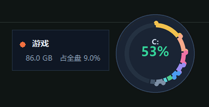
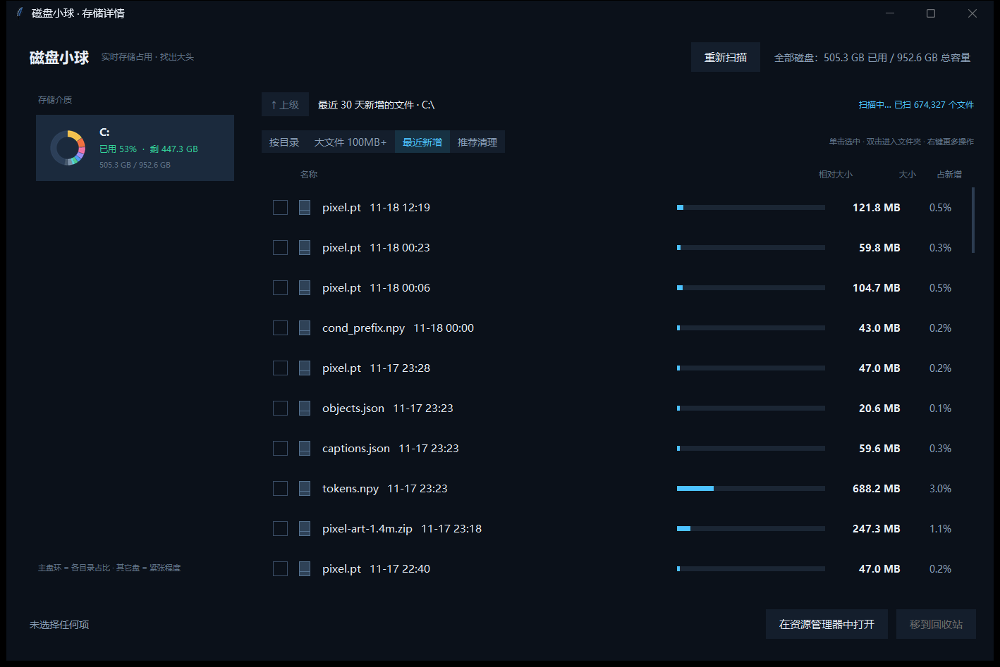

# DiskBall 磁盘小球（原型 v0.1）

桌面悬浮一个圆形小球，实时显示磁盘占用；点开就是"谁在吃我的硬盘"的排行榜，可以直接勾选删除。

## 怎么跑

双击 `启动 DiskBall.bat`（或命令行 `py diskball.py`）。

启动后屏幕右上角会出现一个小球，位置会记住上次拖动的位置。

小球默认是「小」尺寸（112，125% 缩放下约 140 像素）。想更小/更大：**右键小球 → 小球大小**，选迷你 96 / 小 112 / 中 132 / 大 168，选完立即生效并记住。缩到「迷你」时只显示盘符和百分比，剩余空间等信息在鼠标悬停时浮出。

## 三个交互

| 操作 | 效果 |
| --- | --- |
| 鼠标悬停小球 | 浮出每个盘的实时占用（已用 % / 剩余） |
| 鼠标停在彩色环的某一段 | 该段高亮，浮出「这一段是什么 / 多大 / 占全盘多少」 |
| 单击小球 | 展开"存储详情"面板 |
| 按住拖动 | 把小球挪到任意位置 |
| 右键小球 | 查看详情 / 立即刷新 / **小球大小** / **开机自启动**（可勾选取消） / 退出 |

开机自启动写在 `HKCU\Software\Microsoft\Windows\CurrentVersion\Run` 的 `DiskBall` 值里，只影响当前用户、不需要管理员，右键菜单里取消勾选就会删掉这条，不留残留。

## 彩色分段环（谁是大头，一眼看出）

小球最外圈那条环不是单色进度条，而是按**当前盘根目录下各文件夹的体积**切成不同颜色的段：

- 段长 = 该项占整盘的比例；最大的一项从 12 点方向顺时针开始
- 配色按大小依次分配：黄 → 橙 → 粉 → 紫 → 蓝 → 绿 → 青（取占盘 ≥1.2% 的前 7 项）
- 剩下的零碎项合并成灰色「其他小项」
- 最后两块是「系统 / 未统计」（读不到的部分）和「剩余空间」（深灰，代表没用掉的容量）

把鼠标移到某一段上，这一段会亮起来，球的外侧弹出小框：色点 + 该项名字 + 体积 + 占全盘百分比。鼠标停在中间，则还是原来的各盘占用浮框。

数据会缓存到 `%LOCALAPPDATA%\DiskBall\structure.json`：**下次启动先用上次的结果把环画出来**，后台再重扫一遍覆盖；之后每 15 分钟自动刷新，删除 / 清理完成后立即重扫。

详情面板里：左侧是每个盘的总容量 / 已用 / 剩余卡片（**主盘的小环和桌面小球一样按目录分色**，其它盘按紧张程度着色）；右侧有四个标签——`按目录`（排行）、`大文件 100MB+`、`最近新增`、`推荐清理`。

## "大头 / 小头"怎么看

- **条形长度** = 相对占用（相对当前列表里最大的一项）
- **大小 / 占本盘**两列 = 绝对值 + 占全盘百分比
- 列表上方一行汇总：`本目录合计 · 前 3 项占 xx% · 大头：xxx`
- **双击文件夹**可以一层层钻进去，直到定位到真正的大头
- 切到「大文件 100MB+」标签，直接列出整个盘里的大文件

## 「最近新增」标签

用来回答"最近装了什么、下载了什么，占了多少地方"：

- 扫整个当前盘，挑出**最近 30 天内创建、且 ≥20MB** 的文件，按时间从新到旧排（最多 300 条）
- 名称后面直接带创建时间，右侧「占新增」= 该项占这批新增总量的比例
- 自动跳过 `Windows`、`Temp`、`WinSxS`、`SoftwareDistribution`、回收站、`node_modules` 这类目录——里面的"新增"多是系统更新和缓存，不是用户新装的东西
- 和其它标签一样：单击勾选、双击定位到文件所在目录、右键更多操作、可以勾选后移到回收站

## 推荐清理（第四个标签）

自动统计下面这些可回收的空间，勾选后一键清理：

| 项目 | 说明 | 风险 |
| --- | --- | --- |
| 用户临时文件 `%TEMP%` | 程序运行时的临时文件 | 安全可删 |
| 系统临时文件 `C:\Windows\Temp` | 受保护/占用中的文件自动跳过 | 安全可删 |
| 缩略图与图标缓存 | 资源管理器会自己重建 | 安全可删 |
| Windows 更新下载缓存 | 装完的更新包残留 | 需管理员 |
| 崩溃转储（Minidump / MEMORY.DMP / CrashDumps） | 只有排障时才用得上 | 安全可删 |
| Python pip / npm / Yarn 缓存 | 下次安装会重新下载 | 安全可删 |
| 回收站 | 里面是已删除项 | **不可恢复，默认不勾** |

另外还有「仅报告、不提供删除」的项：休眠文件 `hiberfil.sys`、旧系统备份 `Windows.old`——只告诉你它们占了多少、该怎么处理（比如 `powercfg /h off`），不在这个工具里删。

清理逻辑和上面的删除不一样：缓存类**直接删除、不进回收站**（否则空间根本不会释放），删除前同样会弹确认框并列出合计大小；正在被占用的文件会跳过。回收站是单独勾选的，清空后无法恢复。

## 删除功能的安全规则

删除按 `doubao-pc-optimizer` 的清理安全规范实现：

- 一律走 Windows Shell 接口 → **进回收站**，可以随时还原，代码里没有永久删除
- 每次删除前弹确认框，列出条数 + 合计大小
- 以下位置直接禁止删除（点了也会被拦下）：
  - 盘符根目录（`C:\`）
  - `C:\Windows` 及其所有子目录
  - `C:\Program Files`、`Program Files (x86)`、`ProgramData`、`$Recycle.Bin`、`System Volume Information`
  - 用户主目录本身、桌面 / 文档 / 下载 / 图片 / 视频 / 音乐 这些库的**根节点**（里面的具体文件可以删）

## 安全设计（代码层面）

| 机制 | 说明 |
| --- | --- |
| 回收站 | 普通删除一律走 Shell 接口，可还原 |
| 路径白名单 | 盘符根、`C:\Windows` 及子目录、Program Files/ProgramData 根、回收站目录、用户库根节点 一律禁删 |
| 链接护栏 | 清理缓存时遇到 junction / 符号链接，只摘掉链接本身，**绝不顺着它递归删到别处**（防止 `%TEMP%` 里藏一个指向重要目录的联接点） |
| 审计日志 | 每次删除 / 清理写入 `%LOCALAPPDATA%\DiskBall\audit.log`（时间、动作、路径），事后可查 |
| 崩溃日志 | 异常写入 `error.log`，不会静默消失（pythonw 没有控制台） |
| 最小权限 | 全程普通用户权限运行，不请求管理员、不联网、不上传任何数据；注册表只写一条 `HKCU\...\Run\DiskBall`（开机自启动，可在右键菜单里关掉） |

## 已知限制（原型阶段，故意的）

- C 盘根目录全量扫描约 1~2 分钟（大目录逐个统计）；彩色环会边扫边"长出来"，之后走缓存
- 「最近新增」要整盘走一遍，C 盘大约几分钟；扫描中列表持续更新
- 被程序占用的文件会删除失败，界面会提示原因
- 还没有：托盘图标、多显示器位置记忆
- 只读盘、网络盘能显示占用，但扫描会很慢

## 文件说明

| 文件 | 作用 |
| --- | --- |
| `diskball.py` | 全部代码，单文件；依赖 Python 3.9+ / tkinter / Pillow |
| `启动 DiskBall.bat` | 双击启动（无控制台窗口） |
| `预览-桌面小球.png` / `预览-分段环与悬浮.png` / `预览-详情面板.png` / `预览-最近新增.png` / `预览-推荐清理.png` | 界面预览 |

配置与运行状态写在 `%LOCALAPPDATA%\DiskBall\`：`config.json`（位置/尺寸）、`structure.json`（上次各目录体积，用于启动即显示彩色环）、`audit.log`（删除审计）。删掉 `config.json` 即可重置小球位置。
